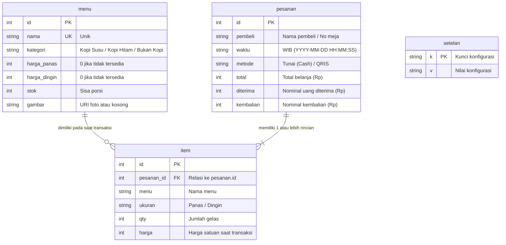

# shelterkopi_ · Kasir & Menu Digital Shelter Kopi

Aplikasi web Point of Sale (POS) kasir dan menu digital untuk **Shelter Kopi**, kedai kopi *outdoor* di Jl. Pantai Labu, Emplasmen Kualanamu, Kec. Beringin, Deli Serdang, Sumatera Utara (Jam operasional 16.00 – 00.00 WIB).

> **Mata Kuliah:** Analisis dan Desain Perangkat Lunak (IF518)  
> **Institusi:** STMIK Pelita Nusantara  
> **Versi:** 1.0 (28 Oktober 2026)  
> **Tim Pengembang:**
> - **Widodo Hadi Siswoyo** (NIM: 240121035)
> - **Gilang** (NIM: 240121034)
> - **Dwi Hadi Wira Utomo** (NIM: 240121113)

---

## ☕ 1. Ringkasan & Latar Belakang Masalah

Aplikasi ini menggantikan pencatatan manual (ingatan barista, nota kertas, kalkulator) yang rentan salah hitung menjadi sistem digital modern, cepat, dan akurat.

| No | Masalah Manual Lama | Solusi Digital `shelterkopi_` |
|:---|:---|:---|
| **M1** | Harga Panas & Dingin berbeda, sebagian menu hanya 1 varian | Varian Panas/Dingin terpisah otomatis, 0% salah hitung (T1) |
| **M2** | Menu cetak laminasi harus dicetak ulang saat ganti harga | Menu Digital interaktif & katalog termutakhirkan seketika (T3) |
| **M3** | Stok minuman tidak terpantau (pembeli kecewa) | Pemantauan stok *real-time*, lencana stok menipis (≤ 5) & habis (FR-02) |
| **M4** | Rekap manual saat tutup jam 00.00 malam memakan waktu | Laporan omset otomatis terbuka ≤ 3 detik dengan 3 grafik analisis (T4) |
| **M5** | Pemilik tidak tahu pesanan baru saat tidak di meja bar | Push notifikasi pesanan seketika ke HP Pemilik via ntfy.sh (T5) |
| **M6** | Catatan transaksi manual mudah hilang | Relasi pesanan dan item tersimpan aman di SQLite lokal `shelterkopi.db` (NF-07) |

---

## 🚀 2. Fitur Unggulan (FR-01 s/d FR-16)

1. **🔐 Autentikasi PIN Terpisah (FR-01, NF-04):**
   - PIN Kasir (default: `1234`) untuk operasional kasir harian.
   - PIN Pemilik (default: `8888`) untuk akses laporan keuangan, koreksi transaksi, dan pengaturan QRIS.
2. **🛒 Katalog Menu & Lencana Stok (FR-02):**
   - Filter kategori (*Kopi Susu, Kopi Hitam, Bukan Kopi*).
   - Indikator stok otomatis: Hijau (Stok aman), Kuning (Sisa ≤ 5), Merah (Habis).
   - Ilustrasi minuman SVG vektor HD tajam atau foto asli unggahan kedai.
3. **🛍️ Keranjang Multi-Item (FR-03, FR-04):**
   - Satu pembeli dapat memesan beberapa menu sekaligus dalam satu struk.
   - Penggabungan otomatis jika menu & varian yang sama ditambahkan ulang.
   - Pembatasan jumlah pesan agar tidak melebihi sisa stok di rak.
4. **💵 Pembayaran Tunai & QRIS (FR-05, FR-06, FR-07):**
   - Validasi nama pembeli / nomor meja wajib diisi.
   - Pembayaran Tunai: tombol nominal cepat (*Pas, 20rb, 50rb, 100rb*), hitung kembalian otomatis, tolak jika uang kurang.
   - Pembayaran QRIS: menampilkan gambar QRIS resmi kedai, pembayaran dihitung pas.
5. **⚡ Transaksi Atomik & Pengurangan Stok (FR-08):**
   - Validasi ulang ketersediaan stok sebelum transaksi disimpan ke basis data.
   - Stok berkurang secara atomik (mencegah *race condition*).
6. **🧾 Struk Teks 34 Karakter (FR-09):**
   - Format pas 34 karakter per baris, kompatibel langsung dengan printer thermal 58mm.
   - Fitur unduh struk dalam format berkas `.txt`.
7. **📲 Notifikasi HP Otomatis via ntfy.sh (FR-10, FR-15):**
   - Ringkasan pesanan langsung terkirim ke ponsel Pemilik tanpa akun dan gratis.
   - Tahan gangguan: jika internet/ntfy gagal, transaksi tetap 100% aman tersimpan di kasir (NF-05).
8. **📋 Menu Digital (FR-11):**
   - **Lembar Menu:** Replika papan menu cetak Shelter Kopi dengan format ribuan rupiah.
   - **Galeri Foto:** Tampilan visual kartu minuman dengan pilihan versi Panas/Dingin.
9. **📦 Kelola Menu & Pemantauan Stok (FR-12):**
   - Tambah menu baru dengan validasi (nama unik, tolak kedua harga 0).
   - Restock cepat dan pembaruan harga.
   - Ganti foto atau kembalikan ke ilustrasi bawaan.
   - Hapus menu dengan konfirmasi.
10. **📊 Laporan Omset & Riwayat (FR-13, FR-14):**
    - Metrik: Total Omset, Omset Hari Ini (WIB), Jumlah Transaksi, Total Gelas Terjual.
    - 3 Grafik: Omset per Menu Minuman, Gelas Panas vs Dingin, Metode Pembayaran.
    - Tabel riwayat transaksi lengkap.
    - Fitur koreksi/hapus pesanan dengan opsi pengembalian (*restock*) porsi menu.
11. **⚙️ Pengaturan QRIS & Backup Database (FR-15, NF-07):**
    - Unggah gambar QRIS statis kedai.
    - Konfigurasi topik ntfy.sh & tombol uji notifikasi.
    - Tombol unduh cadangan `shelterkopi.db` dan panduan pencadangan berkala.
12. **🗄️ Inisialisasi Otomatis 17 Menu Awal (FR-16):**
    - Sistem otomatis membuat skema basis data SQLite dan mengisi 17 menu awal Shelter Kopi pada instalasi pertama.

---

## 🎨 3. Desain & Tema Visual

Aplikasi mengusung **tema gelap arang (*charcoal dark theme*) dengan aksen terakota/bata (*brick accent*)**, merepresentasikan suasana kedai kopi malam hari (*outdoor* 16.00 – 00.00 WIB):
- **Latar Belakang:** Arang gelap (`#18181D`, `#22222A`)
- **Aksen Utama:** Terakota / Bata Hangat (`#D35400`, `#E06D3E`)
- **Aksen Sekunder:** Emas Kopi (`#E5A93C`)
- **Tipografi:** Google Font *Gloock* (klasik estetik) & *Quicksand* (jelas dan mudah dibaca barista)
- **Responsif:** Tampilan optimal pada layar HP (5 inci) hingga laptop kasir (15 inci) (NF-06).

---

## 🗃️ 4. Model Data Relasional (SQLite)



---

## ⚙️ 5. Cara Instalasi & Menjalankan Aplikasi

### Kebutuhan Sistem:
- Python 3.10+
- Modul Python: `streamlit`, `pandas`, `requests`, `pillow`

### Langkah Menjalankan:
1. Pastikan dependensi telah terpasang:
   ```bash
   pip install -r requirements.txt
   ```
2. Jalankan aplikasi Streamlit:
   ```bash
   streamlit run app.py
   ```
3. Buka browser pada alamat lokal:
   ```
   http://localhost:8501
   ```

### Variabel Lingkungan Opsional:
| Variabel | Keterangan | Nilai Default |
|:---|:---|:---|
| `KASIR_PIN` | PIN untuk akses Kasir / Barista | `1234` |
| `OWNER_PIN` | PIN untuk akses Pemilik Kedai | `8888` |
| `NTFY_TOPIC` | Topik push notifikasi ntfy.sh | `shelterkopi-7391` |

---

## 🧪 6. Pengujian & Jaminan Mutu (T1 & NF-03)

Tersedia skrip pengujian otomatis `test_kasir.py` untuk menguji 50 transaksi multi-item acak, validasi stok, dan kasus batas:

```bash
python test_kasir.py
```

### Hasil Pengujian:
- **Selisih Total:** 0% (0 kesalahan dari 50 transaksi uji)
- **Selisih Kembalian:** 0% (0 kesalahan hitung kembalian)
- **Selisih Stok:** 0% (seluruh pengurangan dan pengembalian stok akurat 100%)
- **Validasi Kasus Batas:** Penolakan nama kosong, uang kurang, dan stok habis berhasil 100%.
- **Validasi Struk Thermal:** Panjang baris teks struk tidak melebihi batas lebar 34 karakter.
